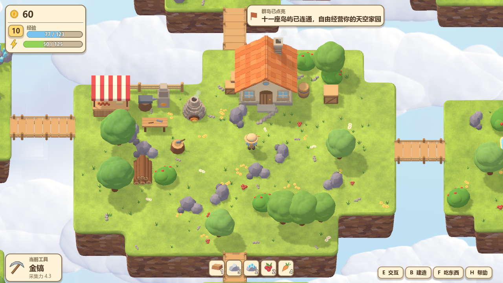

# 天空物语

一款可以离线游玩的中文浮岛经营游戏。从一把石镐开始，采集、烧砖、建市场，再用第一笔 25 金币搭桥去下一座岛。十一座岛上分布着矿脉、瀑布、农田和藏着宝箱的遗迹。

**[下载 Windows 64 位游戏](https://raw.githubusercontent.com/Zhao7135/noname/main/game/sky-tales/Windows/SkyTales-Windows-x64.zip)**

把压缩包解压到任意目录，双击 `SkyTales.exe`，选择「从家园启程」。程序自带引擎和游戏资源，游玩进度自动保存在本机。

| 操作 | 按键 |
| --- | --- |
| 移动、连续采集 | WASD 或方向键，靠近目标后按住鼠标左键 |
| 使用设施、买岛、播种和收获 | E |
| 建造、进食 | B、F |
| 群岛全景、岛民手册、暂停 | M、H、Esc |

使用 Godot 4.7.2 打开 [游戏工程](game/sky-tales/project.godot) 即可编辑或运行。工程包含模型生成、玩法脚本、配乐和音效，以及用于重新生成美术与音频的脚本。[逐段视频复盘与完整玩法说明](docs/天空物语复盘.md)
