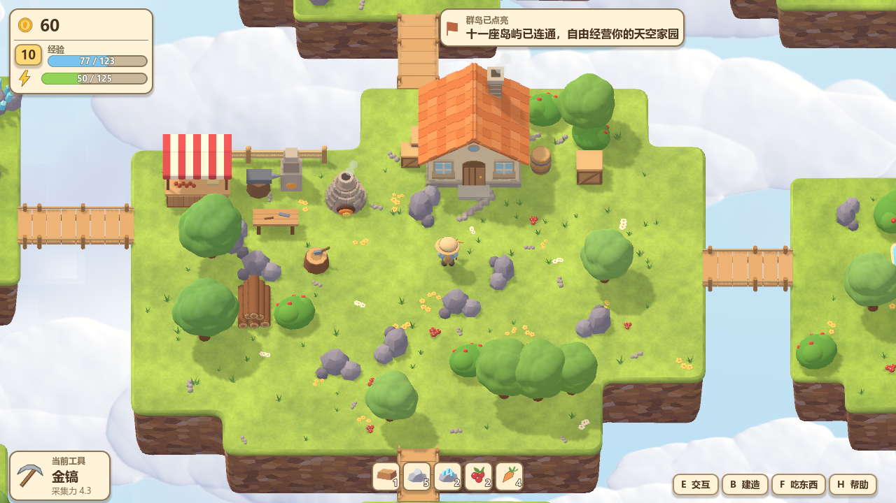
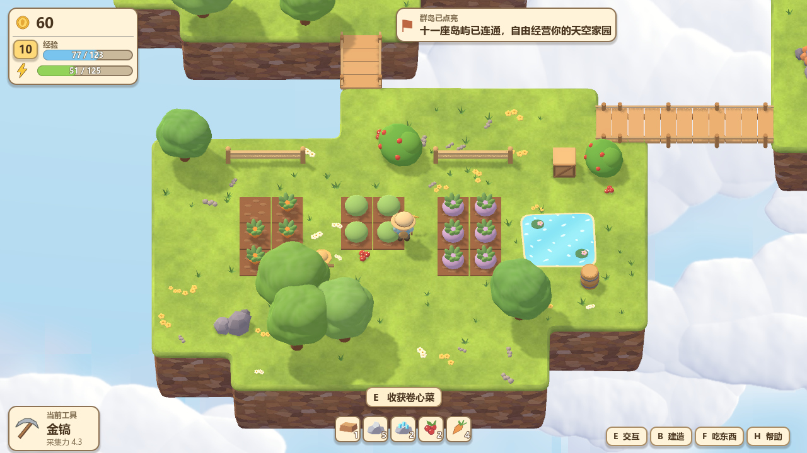

# 《天空物语》逐段复盘与游玩说明

这是一款从一座小岛开始的立体农场经营游戏。砍倒第一棵树、敲碎第一块石头的过程中，玩家学会了挥镐，背包里有了盖市场的材料，也开始积累升级经验。市场开张后，这些劳作才转化成金币。第一笔 25 金币让玩家亲手把路铺到下一座岛，走上去就能接触新的矿物。

参考视频《Claude 8小时 开发天空版星露谷物语》全长约 1 分 54 秒。我对照了抖音作品与同内容的哔哩哔哩视频，从开场到片尾核对画面，并分析了完整的立体声混音。以下时间取近似值，视频中的剪辑会跳过采集和等待。[抖音原视频](https://www.douyin.com/video/7697495698090069299) · [哔哩哔哩视频](https://www.bilibili.com/video/BV1LrJa6PEM8/)

## 视频里发生了什么

| 时间 | 画面与操作 | 对复刻实现的影响 |
| --- | --- | --- |
| 0:00–0:08 | 镜头从云海中的群岛拉近家园。草台下方露出厚岩壁，岛上有橙顶农舍、烟囱、熔炉、工作台、栅栏和料堆。 | 使用有纵深和投影的三维场景。相机从南侧俯视，平滑跟随戴草帽的岛民，靠近树木时仍能辨认人物。 |
| 0:09–0:29 | 玩家靠近树、浆果丛和矿石，按住鼠标左键连续挥镐。目标有名称和耐久条，受击会晃动、迸出碎屑。掉落物飞向人物，背包数字跟着变。 | 一次按住能连续采集。挥镐、目标破碎、物品被拾起各自有反馈，资源与金币分别入账。 |
| 0:30–0:33 | 第一次升级出现三张技能卡。选取力量后，石镐面板的采集力从 1.0 变为 1.3。 | 采集力内部保留小数，界面显示一位小数。玩家可点选或按数字键选择，这次选择会影响之后的每一次采集。 |
| 0:34–0:44 | 走近熔炉按 E。有三种配方和两种批量按钮。人物离开炉边去砍树时，熔炉继续工作。 | 加入队列时扣材料，人物可以离开。进度在炉子上方显示，完工后成品进入背包。 |
| 0:45–0:52 | 按 B 打开三张建筑卡，选择市场后回到地面网格。放置位置随鼠标变化，落成的是红白条纹棚布摊位。 | 放置时检查用地、资源和阻挡，使用绿、红两色预览有效与无效位置。玩家能自己决定市场建在哪里。 |
| 0:53–0:59 | 市场既能卖单件，也能卖掉某项的全部库存。画面中有 8 木头、6 铁矿石和 3 浆果，批量出售显示 26 金币，钱包从 1 变成 27。 | 这笔交易可以验算为 8 × 1 ＋ 6 × 3。批量出售保留食物，浆果仍可手动出售或用来回体力。 |
| 1:00–1:09 | 岛民走到北侧采石场价格牌前，花 25 金币。钱包剩 2，木板依次铺开，人物可以跨过云海。其他价格牌随后显示 45。 | 扣款、岛屿抬升、木桥出现和相邻价格牌更新连在一起。已经买下的地块在存档里保留。 |
| 1:10–1:23 | 采石场密集分布着石头与铁矿。再次升级时出现磁力、耐力、幸运三张卡。 | 新岛改变可采资源的分布。升级收益可以继续累积，选耐力还会立即回满能量。 |
| 1:24–1:39 | 镜头依次展示青蓝水晶矿脉、带莲叶的池水与瀑布、石柱间的宝箱和农田。三片地里的作物外形不同，还能看到稻草人和池塘。 | 水晶可采、宝箱可开、空田可播种。胡萝卜、卷心菜、芜菁分别具有幼苗、生长中与成熟外观。 |
| 1:40–1:54 | 镜头向后拉，十一座岛及木桥逐渐收入全景，最后出现「天空物语」。 | 标题画面使用实际三维群岛。游戏里按 M 也能拉远查看当前开桥情况，再按一次回到人物。 |

## 能从画面读出的数值

| 项目 | 原片显示 |
| --- | --- |
| 初始状态 | 石镐采集力 1.0，能量上限 100。前三段升级进度上限依次是 15、27、39。 |
| 技能 | 力量增加 25% 采集伤害，工匠增加 30% 制作速度，磁力增加 50% 拾取范围，耐力增加 25 点上限并回满，幸运增加 15% 额外掉落几率。 |
| 熔炉 | 2 石头 → 1 砖块，2.0 秒。1 铁矿石 ＋ 1 木头 → 1 铁锭，3.0 秒。1 金矿石 ＋ 1 木头 → 1 金锭，3.5 秒。按钮提供 1 次和 5 次。 |
| 建造 | 熔炉消耗 10 石头、4 木头。市场消耗 8 木头、4 砖块。锻造台消耗 6 砖块、2 铁锭。 |
| 市场与买岛 | 木头、浆果单价各 1 金币，铁矿石单价 3 金币。视频中前两档岛价是 25 和 45 金币。 |
| 任务 | 顶栏共有十项。前六项依次要求采木石、烧四块砖、建市场、攒 25 金币、买第一座新岛、冶炼铁锭。 |

左上角的金币、等级、经验和能量在同一处。目标位于上方，当前工具单独放在左下，已有物品沿底部排开。这样玩家挥镐时能同时看见目标血条和地上掉落，跑到市场才需要展开交易细节。复刻使用中文界面，保留了这种布局。

## 配乐与声音

整条参考混音约 113.8 秒。对左右声道分析后，可以在相隔约 48 秒的位置找到明显重复的和声结构，较短的重复间距出现在约 12、24、36 秒处。前段低音重心循 C、A、F、G 移动，高频声部也反复出现 C、E、G。成片只提供混音，无法据此确认原作者的乐器、音色库或每个独立音效。

复刻配乐采用 80 BPM、4/4 拍，16 小节正好 48 秒。低音与分解和弦保持稳定，钟形旋律、轻拨弦和柔和的键盘声部在上方交替。音符衰减和短混响跨越循环接缝，游戏内可以分别调音乐与音效的音量。

19 个事件音效覆盖地面与木桥脚步、砍木、敲石、击矿、枝叶、拾取、按钮、操作失败、炉火、播种、进食、水声，以及交易、完工、建造、升级、开岛、宝箱。脚步随实际移动触发，靠近水面或运行中的炉子才会触发相应环境声。配乐和这些音效均为本次重新合成。

## 视频没有给出完整规则的地方

| 内容 | 这个版本采用的规则 |
| --- | --- |
| 后四项目标 | 锻造铁镐、收获自己播种的作物、开启遗迹宝箱、连通全部十一座岛。完成后可以继续自由经营。 |
| 群岛 | 按照片尾全景安排家园、采石场、水晶矿洞、池塘岛、金矿山、花草地、古代遗迹、瀑布岛及农田等地块。「林间小岛」「林中湖」是为两处未能辨清名称的地块所取的名字。 |
| 经济与采集 | 第三次扩岛起继续按每次加 20 金币计算。后期物价、掉落量、再生时间、工具升级费用及铸币收益均为本作取值。 |
| 农田与宝箱 | 空田按 E 选择作物。胡萝卜、卷心菜、芜菁分别在 42、60、78 秒成熟。遗迹宝箱仅可开启一次，奖励 90 金币、4 水晶和 2 金锭。原片只展示了这些场景的外观。 |
| 模型与存档 | 岛形、模型、角色动作、材质、图标与音频均重新制作。存档支持离开时保存炉内队列、地面掉落和田地进度，重新启动后从保存处继续。 |

## 开始游玩

下载 [Windows 游戏压缩包](../game/sky-tales/Windows/SkyTales-Windows-x64.zip)，解压后双击 `SkyTales.exe`，选择「从家园启程」。成品包含引擎和资源，可以离线运行。要继续开发，可用 Godot 4.7.2 打开 [project.godot](../game/sky-tales/project.godot)。

| 操作 | 按键 |
| --- | --- |
| 移动、采集 | WASD 或方向键移动，靠近目标后按住鼠标左键 |
| 使用熔炉、市场、农舍、木牌、田地或宝箱 | E |
| 建造 | B 选建筑，左键放置，右键或 Esc 取消 |
| 补体力 | F 吃食物，或在农舍休息 |
| 全景与缩放 | M 查看群岛，鼠标滚轮调整游玩视距 |
| 帮助、暂停与音量 | H 查阅岛民手册，Esc 暂停 |

如果要尽快走到第一座新岛，先给市场留出 8 木头。烧 4 砖需要另外采 8 石头，排入熔炉后就可以去砍树。市场落成再卖材料，攒够 25 金币走到北侧木牌按 E。

## 验证记录

Windows 独立程序从空存档启动，通过游戏窗口点击「从家园启程」，按住左键敲碎出生点旁的岩石。关闭窗口后，存档里保留了 4 石头和 3 点经验。

另外使用导出程序内的游戏资源跑了一次完整流程。测试从零金币和空背包开始，实际结算采集、制造、建造和交易，途中加快等待并把人物移到各个交互点。最终走完十项目标、买齐十一座岛、升级到金镐，逐段检测了每座木桥的通行范围。烧砖中途和作物生长中途均经过存档恢复验证。

在同一份导出资源上，还验证了键盘移动、鼠标按住与松开、菜单按钮、地图切换及暂停恢复。音乐快进到第 47.85 秒后顺利越过接缝，重新从开头播放，混音总线持续有输出。
